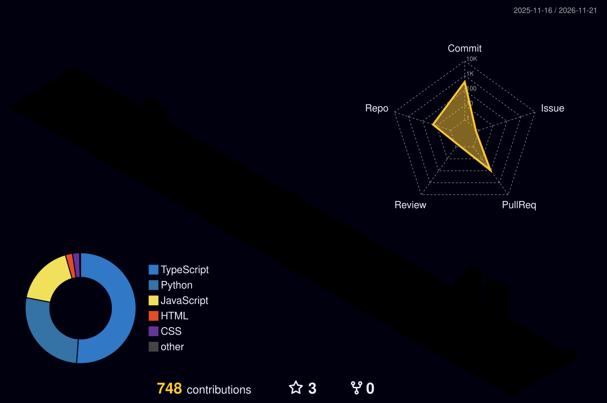

<!-- ═══════════════════ ANIMATED HEADER ═══════════════════ -->

<!-- ═══════════════════ MULTI-LINE TYPING ═══════════════════ -->

 

  

<!-- ═══════════════════ SOCIAL LINKS ═══════════════════ -->

&nbsp;
&nbsp;
&nbsp;

  

&nbsp;

<!-- ═══════════════════ DIVIDER ═══════════════════ -->

<!-- ═══════════════════ ABOUT ME ═══════════════════ -->

##  &nbsp;About Me

I'm a second-year **B.Tech student in CS & Artificial Intelligence** at **Newton School of Technology × Rishihood University** — passionate about building products that solve real problems.

I work at the intersection of **AI, full-stack development, and product thinking**, turning ideas into production-ready applications.

- 🔭 &nbsp;Currently building **Rocky** — an offline-first AI voice assistant
- 🧠 &nbsp;Exploring **Machine Learning**, local LLMs, and system design
- 📊 &nbsp;Deep into **quantitative research** and algorithmic strategies
- 💡 &nbsp;Always shipping — from hackathon MVPs to real-world platforms
- 🤝 &nbsp;Open to **collaborations** on AI and full-stack projects
- ⚡ &nbsp;Fun fact: I debug better at 2 AM than 2 PM

 

<!-- ═══════════════════ NOW WORKING ON ═══════════════════ -->

<!-- ═══════════════════ DIVIDER ═══════════════════ -->

<!-- ═══════════════════ TECH STACK ═══════════════════ -->

##  &nbsp;Tech Stack

  

<!-- Animated Skill Icons -->

  

  

  

<!-- ═══════════════════ DIVIDER ═══════════════════ -->

<!-- ═══════════════════ FEATURED PROJECTS ═══════════════════ -->

##  &nbsp;Featured Projects

 

<table>
<tr>
<td width="50%" valign="top">

### 🎙️ Rocky
**Offline-First AI Voice Assistant**

Local speech recognition, speech synthesis, wake-word detection, and intelligent task execution — all running without internet.

`Node.js` `Python` `whisper.cpp` `ONNX Runtime` `Local LLMs`

</td>
<td width="50%" valign="top">

### 📊 StatVidya
**Smart India Hackathon · MoSPI**

Workforce competency intelligence platform — AI-powered analytics for India's Official Statistical System.

`Next.js 15` `React 19` `TypeScript` `Firebase` `Gemini AI`

</td>
</tr>
<tr>
<td width="50%" valign="top">

### 📚 EduWrap
**Collaborative Study Platform**

Study rooms, flashcards, doubt threads, and student dashboards — everything students need in one place.

`React` `TypeScript` `Vite` `Supabase`

</td>
<td width="50%" valign="top">

### 🌐 V-Portfolio
**Developer Portfolio**

Personal portfolio showcasing my journey, projects, achievements and experience as a developer.

`React` `TypeScript` `Vite`

</td>
</tr>
<tr>
<td width="50%" valign="top">

### 🔁 Progress Loop
**Student Habit Tracker**

Build consistent habits, track personal progress, and develop discipline through streaks and analytics.

`React` `TypeScript` `Supabase`

</td>
<td width="50%" valign="top">

### 🧳 TripSplit
**Expense Splitter**

Split travel expenses, track shared costs, and settle up with friends — simple and intuitive.

`JavaScript` `HTML` `CSS`

</td>
</tr>
</table>

 

<!-- ═══════════════════ DIVIDER ═══════════════════ -->

<!-- ═══════════════════ ACHIEVEMENTS ═══════════════════ -->

##  &nbsp;Achievements & Milestones

 

| &nbsp; | Achievement | Details |
|:---:|:---|:---|
| 🥇 | **WorldQuant BRAIN — Gold Level** | Built 100+ quantitative alphas; two alphas with Sharpe ratios > 2.2 |
| 🇮🇳 | **Smart India Hackathon** | StatVidya — workforce competency intelligence for MoSPI |
| 💼 | **Deloitte Australia** | Data Analytics Job Simulation via Forage |
| 🎓 | **Mentor-Mentee Programme** | Active participant in college mentoring ecosystem |

<!-- ═══════════════════ DIVIDER ═══════════════════ -->

<!-- ═══════════════════ PROBLEM SOLVING ═══════════════════ -->

##  &nbsp;Problem Solving

  

 

<!-- ═══════════════════ DIVIDER ═══════════════════ -->

<!-- ═══════════════════ GITHUB ANALYTICS ═══════════════════ -->

##  &nbsp;GitHub Analytics

  

 

### 🔥 Contribution Streak

 

### 📈 Contribution Graph

  

### 🏙️ 3D Contribution City

<a href="https://github.com/Vamsi-i7">
  <picture>
    <source media="(prefers-color-scheme: dark)" srcset="./profile-3d-contrib/profile-night-rainbow.svg" />
    <source media="(prefers-color-scheme: light)" srcset="./profile-3d-contrib/profile-season-animate.svg" />
    
  </picture>
</a>

 

### 🐍 Watch My Contributions Come Alive

<a href="https://github.com/Vamsi-i7">
  <picture>
    <source media="(prefers-color-scheme: dark)" srcset="https://raw.githubusercontent.com/Vamsi-i7/Vamsi-i7/output/github-contribution-grid-snake-dark.svg" />
    <source media="(prefers-color-scheme: light)" srcset="https://raw.githubusercontent.com/Vamsi-i7/Vamsi-i7/output/github-contribution-grid-snake.svg" />
    
  </picture>
</a>

<!-- ═══════════════════ DIVIDER ═══════════════════ -->

<!-- ═══════════════════ FOOTER ═══════════════════ -->

 

  

&nbsp;

  

